# Magic & Supernatural Systems Compendium

> *Seventeen magic and supernatural engines, from spell slots and binding pacts to warp-spasm mutations and draconic dyads, compared on the same attributes: what a power is, what limits it, and what play feels like.*  
> **Author:** Ashley James Stevens-Hoare (Updated Oct 2026)  
> **Scope:** 17 Mechanical Engines · 6 Core Families · 40+ Game Case Studies · Interactive Design Cross-Reference

---

## Quick Reference Index

| Family | System / Engine | Core Resource | Core Loop | Jump Link |
| :--- | :--- | :--- | :--- | :--- |
| **Resource budget** | `Vancian (slots)` | Daily consumable slot buckets | Attrition: save slots for the boss, stop when they run out | [View Engine](#vancian-slots) |
| **Resource budget** | `Mana / power points` | Scalable numeric pool | Predictable, granular tactical spending | [View Engine](#mana-power-points) |
| **Risk and dice** | `Push-your-luck / burnout` | Risk tolerance and escalating dice | Crisis triage: cast now, knowing a botch could hurt | [View Engine](#push-your-luck-burnout) |
| **Risk and dice** | `Magic Dice (GLOG)` | The d6 pool itself | Decide how many dice to stake | [View Engine](#magic-dice-glog) |
| **Risk and dice** | `Overheat / threshold` | Rising threshold, Peril | Ride the edge: maximum output against forced cooldown | [View Engine](#overheat-threshold) |
| **Paid cost** | `Sacrificial / Faustian` | HP, sanity, memories, standing, collateral damage | Every spell is a weighty, consequential gamble | [View Engine](#sacrificial-faustian) |
| **Paid cost** | `Bidding / narrative debt` | HP or narrative debt and tokens | Bartering consequences with the GM | [View Engine](#bidding-narrative-debt) |
| **Build and assemble** | `Modular / grammatical` | Component knowledge and complexity | Creativity and puzzle-solving over memorized lists | [View Engine](#modular-grammatical) |
| **Build and assemble** | `Deck / hand draft` | Hand of cards, draw rate | Tactical hand management and improvisation | [View Engine](#deck-hand-draft) |
| **Build and assemble** | `Grid / inventory` | Carrying capacity and durability | Managing inventory space and item integrity | [View Engine](#grid-inventory) |
| **Sequence and place** | `State / stance` | Current stance or momentum | Execute the prerequisite actions to open the stance | [View Engine](#state-stance) |
| **Sequence and place** | `Ecological / siphon` | Local magical density of the tile | Move to fertile ground, transform the map | [View Engine](#ecological-siphon) |
| **Relationship** | `Pledge / true-name binding` | Taboos, geases, entity resistance | Pre-combat negotiation, then keeping the restrictions | [View Engine](#pledge-true-name-binding) |
| **Relationship** | `Binder` | Number of vestiges you can bind (starts at 1) | Win the vestige's cooperation through ritual and manage its influence | [View Engine](#binder) |
| **Resource budget** | `Focus / flow (sheer will)` | Short-rest Focus points; positional advantage, stealth, and enemy confusion | Generate advantage from stealth, flank angles, and enemy confusion; spend quickly-replenishing Focus on lethal precision or defensive miracles; reset on a short breather | [View Engine](#focus-flow-sheer-will) |
| **Paid cost** | `The Ríastrad (warp-spasm)` | Mortal anatomy, bone/muscle integrity, agony threshold, and cold-vat recovery | Channel divine/chthonic earth-fury; endure excruciating physical mutation to become an army-cleaving terror; pay the brutal price in physical shock, exhaustion, and cognitive trauma | [View Engine](#the-riastrad-warp-spasm) |
| **Relationship** | `Symbiotic dyad (dragon-rider)` | Dyadic resonance, beast stamina/sleep state, apex caloric & territorial upkeep, rider-mount neural equilibrium | Harmonize human tactical agency and aerial apex devastation; negotiate mutual will; balance the terrifying geopolitical footprint and shared psychic trauma of a bonded titan | [View Engine](#symbiotic-dyad-dragon-rider) |

---

## System Taxonomy & Families

```mermaid
flowchart TD
    Root["Magic & Supernatural Engines (17)"] --> F1["1. Resource Budget"]
    Root --> F2["2. Risk & Dice"]
    Root --> F3["3. Paid Cost"]
    Root --> F4["4. Build & Assemble"]
    Root --> F5["5. Sequence & Place"]
    Root --> F6["6. Relationship"]

    F1 --> S1["Vancian (slots)"]
    F1 --> S2["Mana / power points"]
    F1 --> S15["Focus / flow (sheer will)"]

    F2 --> S3["Push-your-luck / burnout"]
    F2 --> S4["Magic Dice (GLOG)"]
    F2 --> S5["Overheat / threshold"]

    F3 --> S6["Sacrificial / Faustian"]
    F3 --> S7["Bidding / narrative debt"]
    F3 --> S16["The Ríastrad (warp-spasm)"]

    F4 --> S8["Modular / grammatical"]
    F4 --> S9["Deck / hand draft"]
    F4 --> S10["Grid / inventory"]

    F5 --> S11["State / stance"]
    F5 --> S12["Ecological / siphon"]

    F6 --> S13["Pledge / true-name binding"]
    F6 --> S14["Binder"]
    F6 --> S17["Symbiotic dyad (dragon-rider)"]
```

---

## Master Comparison Matrix

| System | Family | A Power/Spell Is... | How It Works | Backlash / What Limits It | Best Suited For | Key Examples |
| :--- | :--- | :--- | :--- | :--- | :--- | :--- |
| **[Vancian (slots)](#vancian-slots)** | Resource budget | A prepared effect drawn from a daily bucket | Spend a slot from a daily bucket | Out of slots | Attrition-based dungeon crawlers | *5e (approximate)* |
| **[Mana / power points](#mana-power-points)** | Resource budget | An effect bought from a pool | Spend points from a numeric pool | Depleted pool | Predictable, granular tactical play | *Rolemaster (approximate)* |
| **[Push-your-luck / burnout](#push-your-luck-burnout)** | Risk and dice | A roll against a DC that escalates | Roll against a DC; the DC rises each cast or round, or a Burn/Entropy die pool builds | A failure or doubles inflicts backlash: temporary ability drain, corruption mutations, reality tears | Grimdark, low-magic, sword-and-sorcery | *Dungeon Crawl Classics, Warhammer Fantasy Roleplay, Shadow of the Demon Lord, Mage: The Awakening (Paradox)* |
| **[Magic Dice (GLOG)](#magic-dice-glog)** | Risk and dice | A pool of allocated d6s | Commit a number of Magic Dice (d6s); their sum sets damage, range or duration | Dice rolling 4-6 are spent until rest (1-3 return); doubles = minor mishap, triples = catastrophic doom | — | *The GLOG* |
| **[Overheat / threshold](#overheat-threshold)** | Risk and dice | A cast that adds Heat or Strain | Each spell adds a set amount of Heat or Strain; higher tiers give passive bonuses | Passing the maximum causes catastrophic shutdown, self-damage or stun | Action-oriented, momentum-driven play | *Warhammer 40k: Darktide / Vermintide (Psyker, Sienna), Lancer, Shadowrun (Drain)* |
| **[Sacrificial / Faustian](#sacrificial-faustian)** | Paid cost | A spell that always works | No roll; the spell always works | Every cast costs permanent HP, memories, sanity, standing or collateral damage; direct damage and irreversible narrative debt | Horror, grim settings, high-stakes fiction | *Spire: The City Must Fall, Dark Sun (D&D Defiling), Unknown Armies* |
| **[Bidding / narrative debt](#bidding-narrative-debt)** | Paid cost | A negotiated narrative change | State the goal; the referee or system sets a debt, or the player auctions concessions | No failure state: the cost is HP or narrative debt accepted up front | — | *Whitehack, Wanderhome, Belonging Outside Belonging* |
| **[Modular / grammatical](#modular-grammatical)** | Build and assemble | A spell assembled on the fly from components | Build a spell from Target/Range + Form/Technique + Element/Noun + Magnitude/Power; each part adds mana cost, casting time or difficulty | High difficulty caps and longer casting time | High-agency investigative and wizard sandboxes | *Ars Magica, Tyranny (video game), Magicka (video game)* |
| **[Deck / hand draft](#deck-hand-draft)** | Build and assemble | Cards or components in a drawn hand | Draw a hand each round; play valid combinations (Element + Shape + Intensity) or single spells timed by the draw | Poor draws and element mismatches | Fast tactical combat, board-game hybrids | *Vast: The Crystal Caverns (The Dragon), Slay the Spire, Book of Demons, Through the Breach (Malifaux TTRPG)* |
| **[Grid / inventory](#grid-inventory)** | Build and assemble | A physical object or block | Spells are items in a grid; casting wears durability, uses hand slots or relies on adjacency | Item capacity and durability; exhaustion clogs the remaining slots | — | *Mausritter, Into the Odd, Noita (video game)* |
| **[State / stance](#state-stance)** | Sequence and place | An endpoint on a combo tree | Basic spells open a stance on a momentum track; advanced spells need a specific point and advance, reverse or reset it | Wrong stance; if disrupted or damaged during buildup, momentum shatters | — | *Final Fantasy XIV (Black Mage), Exalted 3e (Sorcerous Working)* |
| **[Ecological / siphon](#ecological-siphon)** | Sequence and place | Extraction of local terrain | Casting leeches the local terrain, downgrading the tile (Verdant Forest to Dead Earth to Barren Ash) | The tile runs dry; you must move to fertile ground | — | *Magic: The Gathering (tactical board adaptations), Divinity: Original Sin 2* |
| **[Pledge / true-name binding](#pledge-true-name-binding)** | Relationship | A contract with an outside entity | A contested roll or social negotiation done ahead of time; the bound entity then acts automatically | Violating the contract's taboos or geases turns the entity on you or removes the power | — | *Changeling: The Lost (Pledge System), Stormbringer / Elric!* |
| **[Binder](#binder)** | Relationship | A pact with a vestige that grants supernatural abilities | Bind a vestige (a being that wants a mortal's body to act out emotions or pursue goals) to gain supernatural abilities, mostly not spellcasting | Likely stigmata; a possible personality battle like an intelligent magic sword; cultural or ritual requirements for the vestige's cooperation | — | *—* |
| **[Focus / flow (sheer will)](#focus-flow-sheer-will)** | Resource budget | A surge of hyper-focused physical or sensory competence, lethal timing, or evasive instinct | Gain automatic leverage (Advantage) when striking from shadows, elevation, or against bewildered targets; spend Focus to guarantee hits, bypass armor, or execute impossible reflexive evasions; entirely recharges after a short rest (10–15 minutes) | Glass cannon vulnerability when caught out of position or forced into open slugfests; zero resistance against wide-area arcane devastation; exhausting Focus leaves the assassin relying on raw unenhanced steel | Lethal stealth infiltration, tactical martial noir, hyper-competent assassins, John Wick style gun-fu and close-quarters execution | *John Wick (and the 'Baba Yaga' Mythos), Dishonored (Corvo & Daud), Sekiro: Shadows Die Twice, D&D 5e / Shadowdark (Rogue / Monk / Assassin)* |
| **[The Ríastrad (warp-spasm)](#the-riastrad-warp-spasm)** | Paid cost | A terrifying, agonizing somatic distortion where divine or earth power violently warps mortal flesh into a monstrous weapon of nature | The warrior voluntarily opens their body to raw mythological earth-power; muscles grotesquely swell and contort, bones snap and invert, and the warrior transforms into a towering, unrecognizable semi-divine juggernaut that tears through shields and warbands; emits a terrifying aura forcing mass morale collapse | An agonizing somatic burden, not a combat perk: tears muscle fibers, shatters joint cartilage, risks indiscriminate blind frenzy against comrades, and leaves the warrior in a comatose, burning fever requiring days of convalescence or cooling in vats of icy water | Mythic Celtic sword-and-sorcery, body-horror dark fantasy, tragic berserker epics, brutal battlefield set-pieces | *Sláine: The Horned God (Pat Mills & Simon Bisley), The Táin Bó Cúailnge (Irish Myth / Cú Chulainn), The Immortal Hulk (Al Ewing), Berserk (Guts & the Berserker Armor)* |
| **[Symbiotic dyad (dragon-rider)](#symbiotic-dyad-dragon-rider)** | Relationship | A telepathic impulse, shared sensory communion, or coordinated catastrophic strike channeled through a bonded colossal entity | Player commands a dual-character entity: the rider handles fine ground manipulation, social compacts, and infiltration; the dragon delivers colossal mass, aerial supremacy, and city-razing breath weapons. Actions and telepathic senses are shared across the psychic link | Shared trauma and sympathetic death: if the dragon is injured or slain, the rider suffers catastrophic neural shock, madness, or death; colossal logistical burdens (devouring whole herds of cattle); ancient draconic pride and stubbornness; prolonged dormant hibernation (Melnibonéan slumber) | Geopolitical high fantasy, apocalyptic aerial warfare, bonded companion sagas, dynastic bloodline campaigns | *Elric of Melniboné (Michael Moorcock), Dragonriders of Pern (Anne McCaffrey), A Song of Ice and Fire / Game of Thrones (George R.R. Martin), Drakengard (Caim & Angelus)* |

---

## Detailed Engine Breakdowns by Family

### 1. Family: Resource budget

> **Family Philosophy:** Mechanics defined by quantifiable reservoirs (daily slot buckets, point pools, or fast-recharging short-rest Focus). Play revolves around conservation, attrition, and calculated tactical deployment.

#### Vancian (slots)

- **Family:** `Resource budget`
- **Nature of a Power:** A prepared effect drawn from a daily bucket
- **Core Resource:** `Daily consumable slot buckets`
- **Core Loop:** *Attrition: save slots for the boss, stop when they run out*

**How Activation Operates:**
> Spend a slot from a daily bucket

**Constraints & Failure States (Backlash):**
> ⚠️ **Limitation / Risk:** Out of slots

**Ideal Genre & Campaign Fit:**
> 🎯 **Best Suited For:** Attrition-based dungeon crawlers

**Real-World Case Studies & Implementations:**

* **5e (approximate):** Spell slots

---

#### Mana / power points

- **Family:** `Resource budget`
- **Nature of a Power:** An effect bought from a pool
- **Core Resource:** `Scalable numeric pool`
- **Core Loop:** *Predictable, granular tactical spending*

**How Activation Operates:**
> Spend points from a numeric pool

**Constraints & Failure States (Backlash):**
> ⚠️ **Limitation / Risk:** Depleted pool

**Ideal Genre & Campaign Fit:**
> 🎯 **Best Suited For:** Predictable, granular tactical play

**Real-World Case Studies & Implementations:**

* **Rolemaster (approximate):** Power points

---

#### Focus / flow (sheer will)

- **Family:** `Resource budget`
- **Nature of a Power:** A surge of hyper-focused physical or sensory competence, lethal timing, or evasive instinct
- **Core Resource:** `Short-rest Focus points; positional advantage, stealth, and enemy confusion`
- **Core Loop:** *Generate advantage from stealth, flank angles, and enemy confusion; spend quickly-replenishing Focus on lethal precision or defensive miracles; reset on a short breather*

**How Activation Operates:**
> Gain automatic leverage (Advantage) when striking from shadows, elevation, or against bewildered targets; spend Focus to guarantee hits, bypass armor, or execute impossible reflexive evasions; entirely recharges after a short rest (10–15 minutes)

**Constraints & Failure States (Backlash):**
> ⚠️ **Limitation / Risk:** Glass cannon vulnerability when caught out of position or forced into open slugfests; zero resistance against wide-area arcane devastation; exhausting Focus leaves the assassin relying on raw unenhanced steel

**Ideal Genre & Campaign Fit:**
> 🎯 **Best Suited For:** Lethal stealth infiltration, tactical martial noir, hyper-competent assassins, John Wick style gun-fu and close-quarters execution

**Real-World Case Studies & Implementations:**

* **John Wick (and the 'Baba Yaga' Mythos):** A man of focus, commitment, and sheer will; leverages room geometry, concealment, and panicked disorientation to execute flawless lethal takedowns, catching his breath between waves to fully reset.
* **Dishonored (Corvo & Daud):** Supernatural assassins chaining Blink, Bend Time, and Dark Vision from high ledges; stealth and elevation provide immediate lethal execution angles.
* **Sekiro: Shadows Die Twice:** Posture, stealth deathblows, and instantaneous reset; victory is achieved through posture breaks, misdirection, and unrelenting poise rather than big mana bars.
* **D&D 5e / Shadowdark (Rogue / Monk / Assassin):** Short-rest Ki and Cunning Action/Assassinate mechanics where surprise, hiding, and positioning grant massive damage multipliers, resetting with a mere 10-minute to 1-hour breather.

---

### 2. Family: Risk and dice

> **Family Philosophy:** Mechanics driven by volatility, escalating probability curves, and push-your-luck stakes. Magic is inherently unstable, dangerous, and prone to catastrophic backlash.

#### Push-your-luck / burnout

- **Family:** `Risk and dice`
- **Nature of a Power:** A roll against a DC that escalates
- **Core Resource:** `Risk tolerance and escalating dice`
- **Core Loop:** *Crisis triage: cast now, knowing a botch could hurt*

**How Activation Operates:**
> Roll against a DC; the DC rises each cast or round, or a Burn/Entropy die pool builds

**Constraints & Failure States (Backlash):**
> ⚠️ **Limitation / Risk:** A failure or doubles inflicts backlash: temporary ability drain, corruption mutations, reality tears

**Ideal Genre & Campaign Fit:**
> 🎯 **Best Suited For:** Grimdark, low-magic, sword-and-sorcery

**Real-World Case Studies & Implementations:**

* **Dungeon Crawl Classics:** Spells have no static effect; a d20 + modifiers check sets magnitude on a chart; a natural 1 triggers Spellburn (sacrificing physical stats) or Misfire/Corruption
* **Warhammer Fantasy Roleplay, Shadow of the Demon Lord:** Magic draws on raw Chaos/Warp; casters accumulate strain or risk a "Curse of Tzeentch" or "Madness" catastrophe table
* **Mage: The Awakening (Paradox):** Magic that violates consensus reality generates Paradox dice; even a successful spell leaves Paradox that damages the caster's soul or summons hostile entities

---

#### Magic Dice (GLOG)

- **Family:** `Risk and dice`
- **Nature of a Power:** A pool of allocated d6s
- **Core Resource:** `The d6 pool itself`
- **Core Loop:** *Decide how many dice to stake*

**How Activation Operates:**
> Commit a number of Magic Dice (d6s); their sum sets damage, range or duration

**Constraints & Failure States (Backlash):**
> ⚠️ **Limitation / Risk:** Dice rolling 4-6 are spent until rest (1-3 return); doubles = minor mishap, triples = catastrophic doom

**Real-World Case Studies & Implementations:**

* **The GLOG:** A pool of 1 to 4 Magic Dice (typically d6s); you invest some in a spell and their sum sets magnitude

---

#### Overheat / threshold

- **Family:** `Risk and dice`
- **Nature of a Power:** A cast that adds Heat or Strain
- **Core Resource:** `Rising threshold, Peril`
- **Core Loop:** *Ride the edge: maximum output against forced cooldown*

**How Activation Operates:**
> Each spell adds a set amount of Heat or Strain; higher tiers give passive bonuses

**Constraints & Failure States (Backlash):**
> ⚠️ **Limitation / Risk:** Passing the maximum causes catastrophic shutdown, self-damage or stun

**Ideal Genre & Campaign Fit:**
> 🎯 **Best Suited For:** Action-oriented, momentum-driven play

**Real-World Case Studies & Implementations:**

* **Warhammer 40k: Darktide / Vermintide (Psyker, Sienna):** Casting builds Peril or Overcharge; effects and crit chance grow toward 100%, where the caster detonates unless they vent
* **Lancer:** Mech systems, including paracausal tech, produce Heat; overheating brings reactor stress, exposed structures or meltdown, so you spend turns cooling or venting
* **Shadowrun (Drain):** Each spell has a Drain code; you roll to resist fatigue/stun, and if the spell's Force exceeds your Magic attribute the Drain becomes physical, lethal damage

---

### 3. Family: Paid cost

> **Family Philosophy:** Mechanics where magic never misses, but extracts a guaranteed toll from mortal vitality, somatic flesh-integrity (Warp-Spasms), sanity, or narrative collateral. Every spell is a Faustian transaction.

#### Sacrificial / Faustian

- **Family:** `Paid cost`
- **Nature of a Power:** A spell that always works
- **Core Resource:** `HP, sanity, memories, standing, collateral damage`
- **Core Loop:** *Every spell is a weighty, consequential gamble*

**How Activation Operates:**
> No roll; the spell always works

**Constraints & Failure States (Backlash):**
> ⚠️ **Limitation / Risk:** Every cast costs permanent HP, memories, sanity, standing or collateral damage; direct damage and irreversible narrative debt

**Ideal Genre & Campaign Fit:**
> 🎯 **Best Suited For:** Horror, grim settings, high-stakes fiction

**Real-World Case Studies & Implementations:**

* **Spire: The City Must Fall:** Magic inflicts Stress on health, mind, reputation or gear; when thresholds break, the character suffers permanent narrative Fallout
* **Dark Sun (D&D Defiling):** Preserving draws ambient energy; Defiling drains the life from surrounding vegetation and soil to supercharge the spell, turning fertile land to ash and alerting enemies
* **Unknown Armies:** Magic runs on obsessive paradoxes and gathering charges; Episomancy needs self-inflicted injury, Plutomanical magic needs hoarded wealth you do not spend

---

#### Bidding / narrative debt

- **Family:** `Paid cost`
- **Nature of a Power:** A negotiated narrative change
- **Core Resource:** `HP or narrative debt and tokens`
- **Core Loop:** *Bartering consequences with the GM*

**How Activation Operates:**
> State the goal; the referee or system sets a debt, or the player auctions concessions

**Constraints & Failure States (Backlash):**
> ⚠️ **Limitation / Risk:** No failure state: the cost is HP or narrative debt accepted up front

**Real-World Case Studies & Implementations:**

* **Whitehack:** A broad miraculous title (the Binder, the Pyromancer); the referee names an HP cost by plausibility and drama, and you can cast anything in your tradition if you pay it from your life total
* **Wanderhome, Belonging Outside Belonging:** Token bidding: take "weak" moves (reveal an insecurity, yield ground, create collateral trouble) to earn tokens, then spend them to alter the environment or work magic without chance

---

#### The Ríastrad (warp-spasm)

- **Family:** `Paid cost`
- **Nature of a Power:** A terrifying, agonizing somatic distortion where divine or earth power violently warps mortal flesh into a monstrous weapon of nature
- **Core Resource:** `Mortal anatomy, bone/muscle integrity, agony threshold, and cold-vat recovery`
- **Core Loop:** *Channel divine/chthonic earth-fury; endure excruciating physical mutation to become an army-cleaving terror; pay the brutal price in physical shock, exhaustion, and cognitive trauma*

**How Activation Operates:**
> The warrior voluntarily opens their body to raw mythological earth-power; muscles grotesquely swell and contort, bones snap and invert, and the warrior transforms into a towering, unrecognizable semi-divine juggernaut that tears through shields and warbands; emits a terrifying aura forcing mass morale collapse

**Constraints & Failure States (Backlash):**
> ⚠️ **Limitation / Risk:** An agonizing somatic burden, not a combat perk: tears muscle fibers, shatters joint cartilage, risks indiscriminate blind frenzy against comrades, and leaves the warrior in a comatose, burning fever requiring days of convalescence or cooling in vats of icy water

**Ideal Genre & Campaign Fit:**
> 🎯 **Best Suited For:** Mythic Celtic sword-and-sorcery, body-horror dark fantasy, tragic berserker epics, brutal battlefield set-pieces

**Real-World Case Studies & Implementations:**

* **Sláine: The Horned God (Pat Mills & Simon Bisley):** Sláine channels the Earth Goddess's power into the terrifying ríastrad; his body warps grotesquely into an unrecognizable muscular titan, cleaving through Fomorian armies while enduring excruciating physical torment.
* **The Táin Bó Cúailnge (Irish Myth / Cú Chulainn):** The original mythological warp-spasm: calves spin to the front, one eye sinks into the skull while the other bulges out, a jet of black blood erupts from his scalp (the Lon Laíth), and three vats of cold water are required to quench his boiling fury before he destroys his own kin.
* **The Immortal Hulk (Al Ewing):** Grotesque, agonizing somatic metamorphosis where the vessel is painfully rearranged from the inside out into an unkillable avatar of cosmic rage.
* **Berserk (Guts & the Berserker Armor):** The armor bites into flesh and pins splintered bones together, keeping the body upright through pure trauma and horrific pain while blinding the warrior with bloodlust.

---

### 4. Family: Build and assemble

> **Family Philosophy:** Mechanics where spells are emergent physical or combinatorial constructs. Casters synthesize effects from grammar tokens, hands of drawn cards, or spatial inventory grids.

#### Modular / grammatical

- **Family:** `Build and assemble`
- **Nature of a Power:** A spell assembled on the fly from components
- **Core Resource:** `Component knowledge and complexity`
- **Core Loop:** *Creativity and puzzle-solving over memorized lists*

**How Activation Operates:**
> Build a spell from Target/Range + Form/Technique + Element/Noun + Magnitude/Power; each part adds mana cost, casting time or difficulty

**Constraints & Failure States (Backlash):**
> ⚠️ **Limitation / Risk:** High difficulty caps and longer casting time

**Ideal Genre & Campaign Fit:**
> 🎯 **Best Suited For:** High-agency investigative and wizard sandboxes

**Real-World Case Studies & Implementations:**

* **Ars Magica:** 5 Techniques (Creo, Intellego, Muto, Perdo, Rego) combine with 10 Forms (Ignem, Terram, Corpus, Mentem and others); Creo Ignem creates fire, and difficulty scales with range, duration and volume
* **Tyranny (video game):** Sigils: a Core (Fire, Frost, Life), an Expression (Cone, Bolt, Aura) and Accents (range, armor piercing, bounce), all capped by the Lore stat
* **Magicka (video game):** Real-time combination of 8 elements; opposing elements cancel and specific sequences trigger complex effects

---

#### Deck / hand draft

- **Family:** `Build and assemble`
- **Nature of a Power:** Cards or components in a drawn hand
- **Core Resource:** `Hand of cards, draw rate`
- **Core Loop:** *Tactical hand management and improvisation*

**How Activation Operates:**
> Draw a hand each round; play valid combinations (Element + Shape + Intensity) or single spells timed by the draw

**Constraints & Failure States (Backlash):**
> ⚠️ **Limitation / Risk:** Poor draws and element mismatches

**Ideal Genre & Campaign Fit:**
> 🎯 **Best Suited For:** Fast tactical combat, board-game hybrids

**Real-World Case Studies & Implementations:**

* **Vast: The Crystal Caverns (The Dragon):** As the notes put it, the dragon wakes by managing unique hand-drawn tiles and card combinations to alter its state and navigate underground
* **Slay the Spire, Book of Demons:** Card-based casting; energy pools cap how many spell cards chain in one turn
* **Through the Breach (Malifaux TTRPG):** A standard poker-card Fate Deck; casting meets target numbers, and players can cheat fate by playing cards from a private hand

---

#### Grid / inventory

- **Family:** `Build and assemble`
- **Nature of a Power:** A physical object or block
- **Core Resource:** `Carrying capacity and durability`
- **Core Loop:** *Managing inventory space and item integrity*

**How Activation Operates:**
> Spells are items in a grid; casting wears durability, uses hand slots or relies on adjacency

**Constraints & Failure States (Backlash):**
> ⚠️ **Limitation / Risk:** Item capacity and durability; exhaustion clogs the remaining slots

**Real-World Case Studies & Implementations:**

* **Mausritter, Into the Odd:** Spells are inventory cards or tiles taking 1 or 2 slots, competing with food, weapons and armor; usage dots track use, casting exhausts and clogs slots, recharging needs an in-world procedure (a stone left in a forge)
* **Noita (video game):** Wands have hardware stats (Cast Delay, Recharge Time, Mana Max, Mana Charge Speed, Spread, Capacity); spells slot in like code routines, e.g. Trigger Projectile, Multicast, 3x Chainsaw + Damage Plus

---

### 5. Family: Sequence and place

> **Family Philosophy:** Mechanics governed by momentum tracks, rhythmic stance transitions, or geographical exploitation of the battlefield and regional ecology.

#### State / stance

- **Family:** `Sequence and place`
- **Nature of a Power:** An endpoint on a combo tree
- **Core Resource:** `Current stance or momentum`
- **Core Loop:** *Execute the prerequisite actions to open the stance*

**How Activation Operates:**
> Basic spells open a stance on a momentum track; advanced spells need a specific point and advance, reverse or reset it

**Constraints & Failure States (Backlash):**
> ⚠️ **Limitation / Risk:** Wrong stance; if disrupted or damaged during buildup, momentum shatters

**Real-World Case Studies & Implementations:**

* **Final Fantasy XIV (Black Mage):** Fire spells burn MP and build Astral Fire stacks for peak damage; when dry you shift to Umbral Ice, near-zero damage but fast MP regeneration; a rhythm cycle
* **Exalted 3e (Sorcerous Working):** You accumulate Sorcerous Motes turn by turn through combat shaping actions before the working; disruption or damage shatters the momentum

---

#### Ecological / siphon

- **Family:** `Sequence and place`
- **Nature of a Power:** Extraction of local terrain
- **Core Resource:** `Local magical density of the tile`
- **Core Loop:** *Move to fertile ground, transform the map*

**How Activation Operates:**
> Casting leeches the local terrain, downgrading the tile (Verdant Forest to Dead Earth to Barren Ash)

**Constraints & Failure States (Backlash):**
> ⚠️ **Limitation / Risk:** The tile runs dry; you must move to fertile ground

**Real-World Case Studies & Implementations:**

* **Magic: The Gathering (tactical board adaptations):** Casting capability is governed by the territory you control and tap
* **Divinity: Original Sin 2:** Spells react with surfaces: rain makes puddles, cold freezes a puddle (knockdown checks), electricity shocks it, a poison dart into fire explodes and clouds the area

---

### 6. Family: Relationship

> **Family Philosophy:** Mechanics anchored in pacts, contracts, true names, vestige possession, or telepathic dragon-dyads. Magic is social, legalistic, symbiotic, or parasitic rather than an internal mortal reservoir.

#### Pledge / true-name binding

- **Family:** `Relationship`
- **Nature of a Power:** A contract with an outside entity
- **Core Resource:** `Taboos, geases, entity resistance`
- **Core Loop:** *Pre-combat negotiation, then keeping the restrictions*

**How Activation Operates:**
> A contested roll or social negotiation done ahead of time; the bound entity then acts automatically

**Constraints & Failure States (Backlash):**
> ⚠️ **Limitation / Risk:** Violating the contract's taboos or geases turns the entity on you or removes the power

**Real-World Case Studies & Implementations:**

* **Changeling: The Lost (Pledge System):** Sworn oaths between mortals, fae or the environment: Boons (stat boosts, magical armor) for Tasks (fealty, specific acts), with sanctions (instant death, vulnerability) if broken
* **Stormbringer / Elric!:** Almost no utility or combat spells; magic is summoning and binding demons into weapons, armor or objects, and your magic rating caps how many you bind before they break loose and devour the party

---

#### Binder

- **Family:** `Relationship`
- **Nature of a Power:** A pact with a vestige that grants supernatural abilities
- **Core Resource:** `Number of vestiges you can bind (starts at 1)`
- **Core Loop:** *Win the vestige's cooperation through ritual and manage its influence*

**How Activation Operates:**
> Bind a vestige (a being that wants a mortal's body to act out emotions or pursue goals) to gain supernatural abilities, mostly not spellcasting

**Constraints & Failure States (Backlash):**
> ⚠️ **Limitation / Risk:** Likely stigmata; a possible personality battle like an intelligent magic sword; cultural or ritual requirements for the vestige's cooperation

---

#### Symbiotic dyad (dragon-rider)

- **Family:** `Relationship`
- **Nature of a Power:** A telepathic impulse, shared sensory communion, or coordinated catastrophic strike channeled through a bonded colossal entity
- **Core Resource:** `Dyadic resonance, beast stamina/sleep state, apex caloric & territorial upkeep, rider-mount neural equilibrium`
- **Core Loop:** *Harmonize human tactical agency and aerial apex devastation; negotiate mutual will; balance the terrifying geopolitical footprint and shared psychic trauma of a bonded titan*

**How Activation Operates:**
> Player commands a dual-character entity: the rider handles fine ground manipulation, social compacts, and infiltration; the dragon delivers colossal mass, aerial supremacy, and city-razing breath weapons. Actions and telepathic senses are shared across the psychic link

**Constraints & Failure States (Backlash):**
> ⚠️ **Limitation / Risk:** Shared trauma and sympathetic death: if the dragon is injured or slain, the rider suffers catastrophic neural shock, madness, or death; colossal logistical burdens (devouring whole herds of cattle); ancient draconic pride and stubbornness; prolonged dormant hibernation (Melnibonéan slumber)

**Ideal Genre & Campaign Fit:**
> 🎯 **Best Suited For:** Geopolitical high fantasy, apocalyptic aerial warfare, bonded companion sagas, dynastic bloodline campaigns

**Real-World Case Studies & Implementations:**

* **Elric of Melniboné (Michael Moorcock):** The Dragon Masters of Melniboné summon dragons (like Flamebringer and Stealthglow) using the Dragon Horn; dragons are ancient, proud beings that sleep for centuries in deep caverns and require royal Melnibonéan blood to heed the call.
* **Dragonriders of Pern (Anne McCaffrey):** Telepathic 'Impression' at hatching binds rider and dragon for life in an unbreakable mental communion; they jump through the cold void of 'Between', and if a dragon dies, the rider often throws themselves into the abyss from unbearable grief.
* **A Song of Ice and Fire / Game of Thrones (George R.R. Martin):** Valyrian bloodline magic binds riders to dragons (Balerion, Vhagar, Drogon); dragons are not tamed pets ('a dragon is not a slave'), possess distinct temperaments, and require immense meat and sovereign freedom while reshaping entire wars.
* **Drakengard (Caim & Angelus):** A dark fantasy pact where a mortal trades a vital human faculty (voice, sight, or fertility) to form a shared life-link with an ancient dragon, sharing health and suffering.

---

## Custom Design Sketches & Engine Alignment

Direct mapping from author design sketches to the established mechanical engines:

| Author Design Sketch | Closest Mechanical Engines | Architectural Analysis |
| :--- | :--- | :--- |
| **"Slots, 5e approximately"** | `Vancian (slots)` | Classic attrition curve; strong for dungeon crawls and predictable rest intervals. |
| **"Power points or mana, Rolemaster approximately"** | `Mana / power points` | Granular scaling and points bidding; highly compatible with tactical combat. |
| **"Know a number of spells; can cast until you fail; can keep rolling until the first success as a bonus ability; has a DC"** | `Push-your-luck / burnout` | Push-your-luck risk loop with escalating stakes; creates intense dramatic tension at the table. |
| **"Get a deck of magic; construct a spell from 4 elements etc.; take a leaf out of the "dragon" in Vast or Wheel of Time"** | `Deck / hand draft, Modular / grammatical` | Hybrid combinatorial engine combining hand management with emergent element-mixing. |
| **"Arcana: each spell (1) needs to be known, and (2) comes with multiple costs and consequences"** | `Sacrificial / Faustian, Push-your-luck / burnout` | Faustian cost-bidding combined with catastrophic backlash tables; guarantees dark, visceral flavor. |
| **"A rogue or assassin with man of focus, commitment, sheer will - focus replenishes quickly (short rest), gaining advantage from stealth, positioning, and confusion"** | `Focus / flow (sheer will)` | Short-cycle rapid-recovery focus pool leveraging stealth, elevation, positioning, and enemy confusion. |
| **"Warp spasm barbarian The Ríastrad (Sláine / Cú Chulainn) - divine earth-power violently warping through flesh into a monstrous, unrecognizable shape; an agonizing burden, not an easy combat perk"** | `The Ríastrad (warp-spasm)` | Agonizing somatic burden; divine earth-power violently restructuring anatomy into an army-cleaving monster. |
| **"The dragon riders (Elric of Melniboné, Dragonriders of Pern, Game of Thrones) - dragons and their riders playing an important role as bonded characters"** | `Symbiotic dyad (dragon-rider)` | Symbiotic dyad character model balancing mortal ground agency with colossal aerial apex devastation. |

---

## Agent & Designer Decision Framework

When architecting a magic or supernatural system for a campaign, playbook, or subsystem, evaluate these mechanical trade-offs:

| Campaign / Play Goal | Recommended Engine(s) | Primary Mechanical Trade-off |
| :--- | :--- | :--- |
| **Gritty Survival & Horror** | `Sacrificial / Faustian`, `Push-your-luck / burnout` | High consequence, permanent costs, mortality tension |
| **Mythic Flesh-Warping / Berserker Trauma** | `The Ríastrad (warp-spasm)` | Colossal destructive output paid in agonizing somatic collapse & frenzy |
| **Infiltration & Lethal Neo-Noir** | `Focus / flow (sheer will)` | Short-rest recovery, lethal execution via positioning & stealth, zero armor |
| **Colossal Aerial & Dynastic War** | `Symbiotic dyad (dragon-rider)` | Dual-character agency, shared lethal trauma link, massive logistical upkeep |
| **Tactical Skirmish / Turn-Based** | `Mana / power points`, `State / stance`, `Overheat / threshold` | Granular math, combo execution, cooldown pacing |
| **Dungeon Attrition & Logistics** | `Vancian (slots)`, `Grid / inventory` | Resource accounting, inventory slot contention |
| **Emergent Wizard Sandbox / Agency** | `Modular / grammatical`, `Bidding / narrative debt` | High creative agency, cognitive load, referee negotiation |
| **Fast-Paced Action & Momentum** | `Overheat / threshold`, `Deck / hand draft` | Dynamic risk ceiling, reactive play, minimal calculation |
| **Occult / Folk / Mythic Entanglement** | `Pledge / true-name binding`, `Binder`, `Ecological / siphon` | Narrative taboos, geographic dependency, roleplay friction |

---

## Cross-File Navigation & References

- **Core Rules Compendium:** [Spells & Magic (Core ASH Rules)](10_spells_and_magic.md)
- **Martial Classes (Warp-Spasm Barbarian):** [Martial & Frontier Classes](06_classes_martial.md)
- **Specialist Classes (Focus Assassin):** [Specialist & Infiltrator Classes](06_classes_specialist.md)
- **Narrative Character Archetypes:** [Arcane Archetypes (The Crucible, The Apostate, The Hearth-Tether)](../../arcane_archetypes.md)
- **Stonetop Vancian Implementation:** [The Wizard Playbook](https://github.com/kostchei/ash-rpg/blob/stonetop-exploration/docs/stonetop/playbooks/the_wizard.md)
- **Master Structured JSON Index:** [`data/magic_systems.json`](../../data/magic_systems.json)
- **Standalone Interactive UI:** [Interactive HTML Explorer](magic_system_mechanics.html)